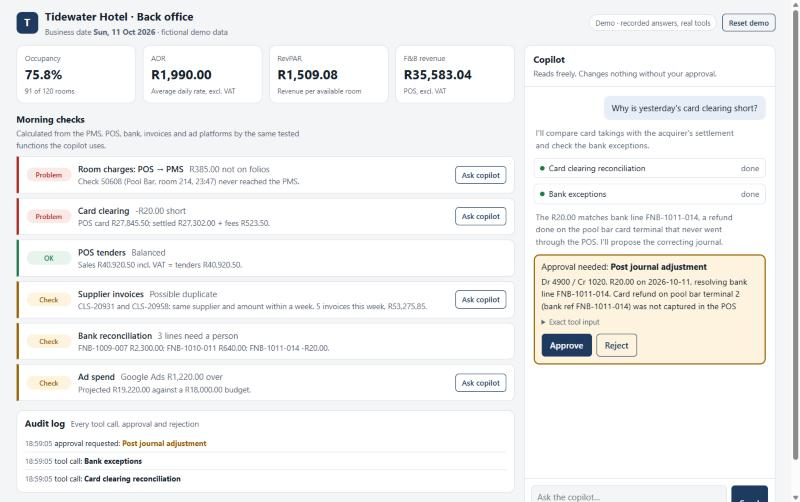
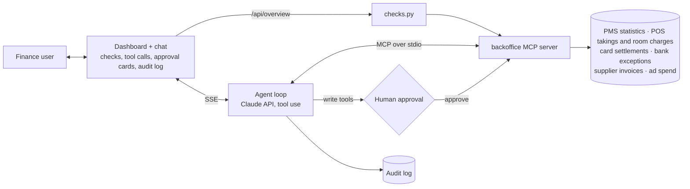

# backoffice-copilot

**A hotel finance team's morning in one screen: the checks they'd otherwise do by hand in
spreadsheets, and a Claude copilot that investigates anything red, shows its working, and
asks before it changes anything.**



*Demo mode: the model's replies are recorded so the app runs without an API key. The MCP
tools, database, approval flow, dashboard and audit log are all real.*

## What it does

**Morning checks.** Every morning finance asks the same questions. Did every POS check
charged to a room reach the PMS? Does card clearing balance? Are there duplicate supplier
invoices? Is ad spend on budget? The dashboard answers them for the business date, next to
occupancy, ADR, RevPAR and F&B revenue.

**The copilot.** Click **Ask copilot** on a red check:

> *"Why don't yesterday's room charges in the POS match the PMS?"*
>
> The copilot compares the POS room-charge checks with the PMS interface postings, finds
> check 50608 (Pool Bar, R385.00, room 214, closed at 23:47) never reached the PMS, and
> proposes posting it to the guest's folio. **Nothing changes until a person clicks
> Approve.** Then the check on the dashboard turns green.



The dashboard and the copilot use the same tested functions in the MCP server, so they
can never disagree about a number.

## Planted problems to find

| Check | Problem | Fix the copilot proposes |
|---|---|---|
| Room charges: POS → PMS | A R385.00 pool bar check charged to room 214 at 23:47 never reached the PMS | Post it to the guest's folio |
| Card clearing | R20.00 short: a refund done on the pool bar card terminal, not in the POS | Journal Dr Sales refunds / Cr Card clearing, and resolve the bank line |
| Supplier invoices | Coastal Linen billed R8,740.00 twice, three days apart | Put the second invoice on hold |
| Ad spend | Google Ads projected R1,220.00 over October's budget | Nothing: that's marketing's decision, so it only reports |

## How it keeps a finance team safe

| Rule | How |
|---|---|
| **Read freely, write only with approval** | Each MCP tool says what it is: `readOnlyHint=True` tools run automatically; every other tool pauses the agent and shows an approval card. Unknown tools are treated as writes. |
| **The model never does the maths** | Every total, VAT split, difference, ADR and projection is calculated in the MCP server with `Decimal`. Claude quotes figures; it doesn't produce them. |
| **And we check that it didn't** | The evaluation set fails any answer containing a rand amount that no tool returned. |
| **Guard rails on writes** | Journals must balance, use real accounts, carry a reason and stay under R1,000. A room charge can't be posted to a folio twice. |
| **Errors are useful** | Bad dates or accounts come back to Claude as clear tool errors so it can correct itself, instead of failing the conversation. |
| **Everything is audited** | Every tool call, approval request, approval and rejection is logged with time, tool, inputs and who decided. |
| **Rejection is respected** | A rejected action goes back to Claude as "the user rejected this", and it isn't proposed again. |
| **Live mode can't run up a bill** | Messages are capped per conversation and per day. Set a spending limit on the API key as well. |

More detail in [`docs/DESIGN.md`](docs/DESIGN.md). How I'd scope this for a real hotel,
written for the finance manager who'd sign it off: [`docs/SCOPE.md`](docs/SCOPE.md).

## Evaluation set

[`evals/cases.json`](evals/cases.json) has seven questions with known-correct outcomes:
the four planted problems, a rejected fix, yesterday's trading, and a date with no data.
Each case runs on a fresh database and checks that the copilot:

- called the right tools,
- proposed the right change (or none, when the decision belongs to someone else),
- didn't propose a rejected change again,
- mentioned the key facts,
- used only amounts that a tool returned,
- left the data in the right state afterwards (for example card clearing balanced).

```bash
python -m copilot.evals          # recorded answers: free, runs in CI on every push
python -m copilot.evals --live   # the Claude API: run before changing the prompt, a tool or the model
```

## What's in it

| Part | File |
|---|---|
| MCP server: 8 read-only tools, 3 tools that need approval, 1 resource | [`mcp_server.py`](src/copilot/mcp_server.py) |
| Morning checks and headline numbers for the dashboard | [`checks.py`](src/copilot/checks.py) |
| Agent loop: Claude tool use, pause/resume for approval, audit | [`agent.py`](src/copilot/agent.py) |
| MCP client over stdio (and an in-process option for tests) | [`backends.py`](src/copilot/backends.py) |
| FastAPI app: dashboard API, chat over Server-Sent Events, reset, live-mode limits | [`web.py`](src/copilot/web.py) |
| Dashboard and chat UI | [`static/`](src/copilot/static) |
| Demo mode: recorded answers that still run the real tools | [`demo.py`](src/copilot/demo.py) |
| Evaluation runner and cases | [`evals.py`](src/copilot/evals.py), [`evals/cases.json`](evals/cases.json) |
| Fictional hotel data with planted problems | [`data.py`](src/copilot/data.py) |

The PMS and POS data is shaped like a hotel PMS such as Opera (daily room statistics,
charges received through the POS interface) and a POS such as Simphony (checks closed to
a room). It is not connected to either product.

## Run it

```bash
python -m venv .venv && source .venv/bin/activate    # Windows: .venv\Scripts\activate
pip install -e ".[dev]"
python -m pytest -q                                  # no API key needed
uvicorn copilot.web:app                              # demo mode, open http://localhost:8000
```

For live answers from Claude, set `ANTHROPIC_API_KEY` before starting. The app switches to
live mode when a key is present; `COPILOT_MODE=demo` or `live` forces one or the other.

**Use the same MCP server from Claude Code or Claude Desktop:**

```bash
claude mcp add backoffice -- python -m copilot.mcp_server
```

## Deploy

The [`Dockerfile`](Dockerfile) runs anywhere that runs containers (Render, Fly.io, a VPS).

- **Public demo:** set `COPILOT_MODE=demo`. No API key, no cost. Visitors share one demo
  database; **Reset demo** puts the planted problems back.
- **Live:** set `ANTHROPIC_API_KEY` from the host's secret store, set a monthly spending
  limit on the key in the Claude Console, and adjust `COPILOT_MESSAGES_PER_SESSION` (default
  12) and `COPILOT_MESSAGES_PER_DAY` (default 300).

## Tech

Python · Claude API (tool use, prompt caching, refusal fallback) · Model Context Protocol
(server and client) · FastAPI · Server-Sent Events · SQLite (swap for PostgreSQL in
production) · vanilla JavaScript · pytest · evaluation set · GitHub Actions · Docker.

## Status and limits

- Demo only: in-memory sessions, no login. In production, sign-in (for example Microsoft
  Entra ID) would identify who approved each action, and only finance roles could approve
  journals.
- The data would come from the real PMS, POS, bank and ERP through the integrations in my
  other repos ([pos-to-ledger](https://github.com/PrenaMoodley/pos-to-ledger),
  [recon-dashboard](https://github.com/PrenaMoodley/recon-dashboard),
  [m365-mail-intake](https://github.com/PrenaMoodley/m365-mail-intake),
  [marketing-spend-sync](https://github.com/PrenaMoodley/marketing-spend-sync)).
- The recorded answers prove the mechanics and the evaluation harness. Run
  `python -m copilot.evals --live` to score the real model.
- All data is fictional.

Built with Claude Code; see [`CLAUDE.md`](CLAUDE.md).

## Licence

MIT
